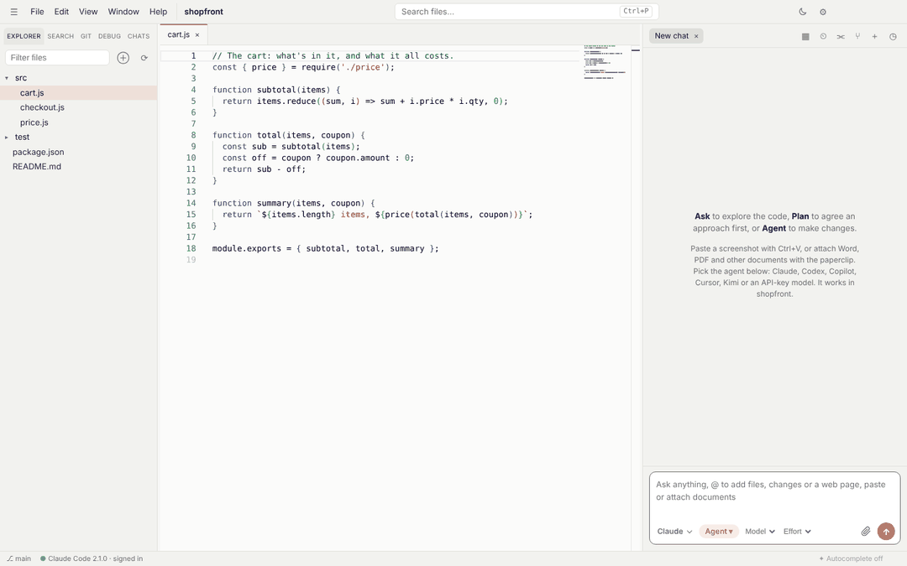
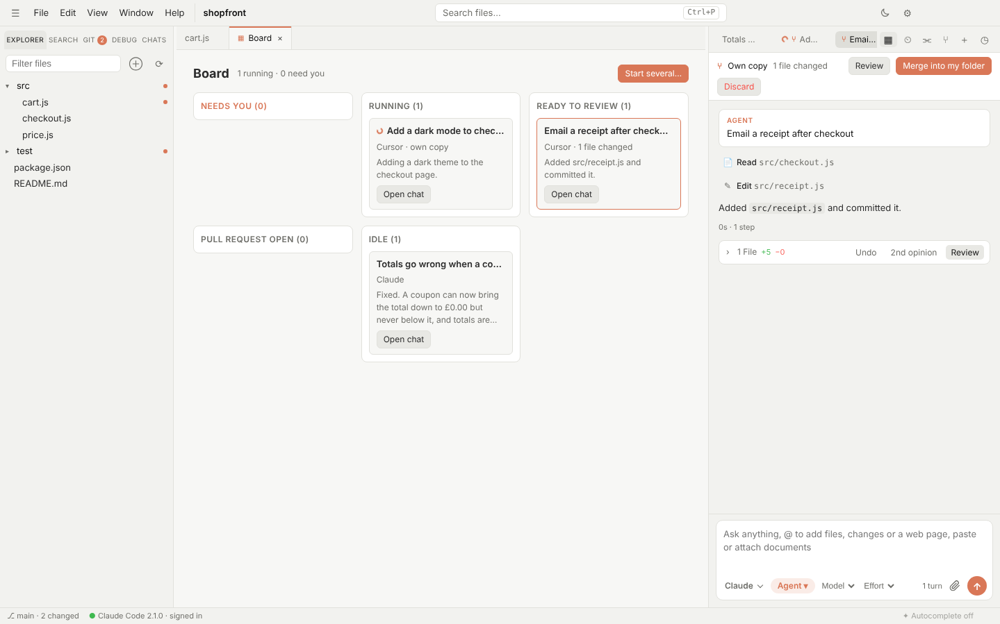
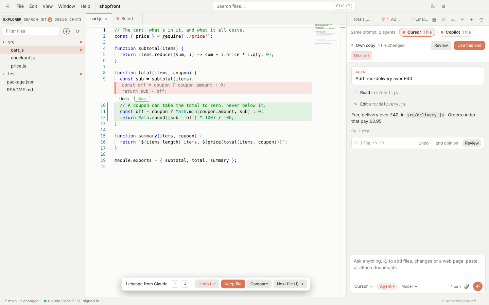
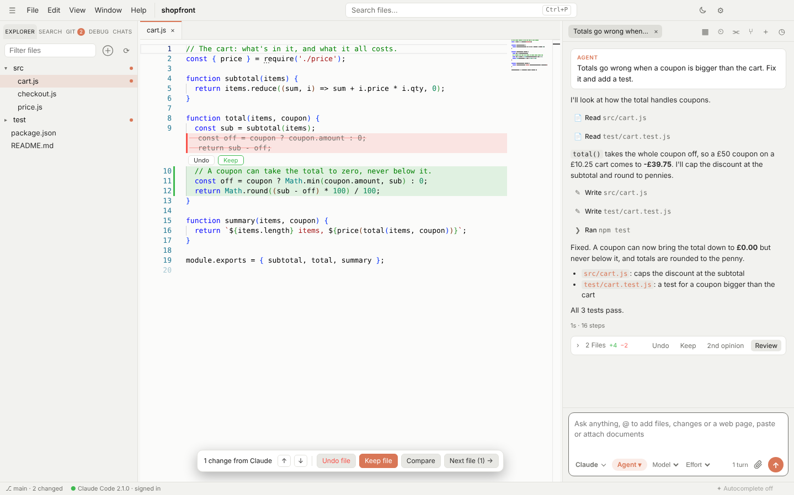
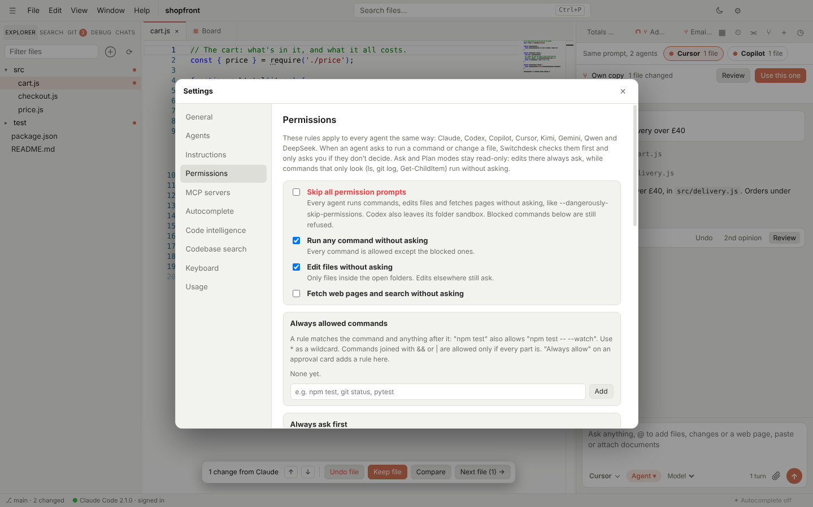
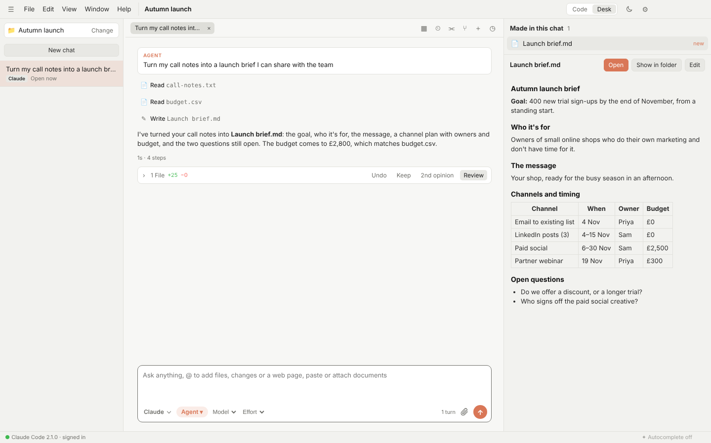

<div align="center">


# Switchdesk

**One desk. Every coding agent.**

A free, open-source, Cursor-style desktop editor for **Claude Code, Codex, GitHub Copilot, Cursor, Kimi, Gemini, Qwen and DeepSeek**.<br>
Each agent runs through its maker's own CLI, signed in with your own plan or API key.

[](https://github.com/SlaterMarketing/switchdesk/releases/latest)
[](https://github.com/SlaterMarketing/switchdesk/releases)
[](LICENSE)
[](https://github.com/SlaterMarketing/switchdesk/releases/latest)

[**Website**](https://switchdesk.dev) · [**Download for Windows, Mac or Linux**](https://github.com/SlaterMarketing/switchdesk/releases/latest) · [Watch the 50-second tour](https://youtu.be/pOJg9oDNDxU) · [Run from source](#run-it) · [Report a bug](https://github.com/SlaterMarketing/switchdesk/issues/new/choose)



</div>

<table>
<tr>
<td><br><sub><b>The board.</b> Start several issues or tasks at once and see what each one needs.</sub></td>
<td><br><sub><b>Same prompt, several agents.</b> Compare what each did, keep the one you like.</sub></td>
</tr>
<tr>
<td><br><sub><b>Inline review.</b> Every change, with Keep and Undo, whichever agent made it.</sub></td>
<td><br><sub><b>One set of permissions.</b> The same rules for Claude, Codex, Copilot, Cursor and the rest.</sub></td>
</tr>
<tr>
<td colspan="2"><br><sub><b>Desk view.</b> Not a coder? Flip to Desk for a plain chat that works on your documents, with everything it makes previewed beside it.</sub></td>
</tr>
</table>

## Supported agents

| Agent | Signs in with | What Switchdesk runs |
| --- | --- | --- |
| Claude Code | Your Claude plan (several accounts side by side) | `claude -p --input-format stream-json` |
| Codex | Your ChatGPT plan or an OpenAI API key | `codex app-server` |
| GitHub Copilot | Your GitHub Copilot plan (`copilot login`) | `copilot --acp` |
| Cursor | Your Cursor plan (`agent login`) | `agent acp` |
| Kimi | Your Kimi Code membership | `kimi acp` |
| Gemini | Your Gemini API key | `gemini --acp` |
| Qwen | Your Alibaba Cloud API key | `qwen --acp` |
| DeepSeek | Your DeepSeek API key, through Qwen Code | `qwen --acp` |

Switchdesk never sees your logins. Switch any chat to another agent or account from the menu in the chat box and the new one picks up the conversation where the last left off, in the same tab.

Switchdesk isn't made by or affiliated with Anthropic, OpenAI, GitHub, Anysphere (Cursor), Moonshot, Google, Alibaba or DeepSeek.

## What you get

- **Code or Desk:** the switch in the top right. **Code** is the editor with the chat beside it. **Desk** is just the chat, in the middle, with your chats down the left, like Claude's desktop app: for writing, research and work on documents, or when you'd rather not look at code. Working in a folder is optional there. Files the agent makes or changes are listed on the right, with a preview (documents as text, images as images) and buttons to open the file in its own app or show it in its folder. Permission cards say what the agent wants in plain words, with the command or change tucked underneath, and a new chat offers a few starting points (summarise a document, draft an email, plan a project). A file or plan you open to edit shows beside the chat until you close it. Both views show the same chats, so you can switch mid-conversation (also View → Switch Between Code and Desk View).
- **Editor:** a Monaco (VS Code) editor with tabs, a file explorer, quick open (`Ctrl+P`) and save (`Ctrl+S`). The theme follows your system, or pick one in Settings.
- **Chat panel** with five modes. Cycle them with `Ctrl+.` or `Shift+Tab` in the chat box.
  - **Ask:** answers questions and never edits files. Any action that would change something is refused automatically.
  - **Plan:** researches first, then opens the plan in its own tab as a formatted document, like Cursor's: file names in it open the file, its to-dos are listed underneath (add your own with **New**) and tick off as the agent builds, and **Edit** switches to the Markdown to change anything. Choose **Build it** (your edited version is what gets built) or **Keep planning** (send feedback). The chat keeps a short card (the plan's title, its overview and how many to-dos) with the same buttons. Open plans come back when you restart Switchdesk, and Build it still works from there. This works with every agent: Claude's plan review, Gemini and Copilot asking to leave plan mode, Cursor's saved plan files, and the plan Codex, Kimi, Qwen and DeepSeek write as their reply.
  - **Agent:** edits files without asking. Before Claude runs a shell command, you get an Allow / Always allow / Deny card.
  - **Debug:** for bugs that are hard to pin down. The agent lists likely causes, adds temporary logging to test them, and asks you to reproduce the bug. The logs come back to Switchdesk (from Node, Python or the browser), the agent reads them and fixes the cause from the evidence, and **Done, clean up** removes the logging. Works with every agent.
  - **Auto:** Claude Code's auto mode. A safety classifier approves actions, and anything it won't approve comes to you as a card.
- **Chat tabs:** run several conversations side by side, each with its own Claude process. A spinner shows which ones are working, and the usage line shows turns and context size per chat.
- **No folder needed to chat:** with no folder open, the chat works as a plain AI chat with any agent. It runs in a folder of its own (`~/.switchdesk/chats`), so anything an agent writes lands there, and those chats show under Chats.
- **Subagents:** click a subagent's row in the chat to open it over the chat: the task it was given, its thinking, the tools it used and what it reported, live while it runs (past chats too). When Claude runs subagents in the background, the chat says it's waiting for them, and Claude carries on by itself when they report back, plan and approvals included.
- **Images:** paste a screenshot (`Ctrl+V`) or drag one onto the chat box.
- **Changes card after each turn:** a collapsed row (› 2 Files · Undo · Keep · Review) that expands to show every file the turn changed, including files changed by shell commands, with +/− counts and a diff. You can **Undo** each file or **Undo all**. In the diff, every change has its own **Undo** and **Keep** buttons.
- **Inline review:** Claude's edits show up right in the editor, with added lines in green and removed lines in red. Every change has its own **Keep** and **Undo**, and a bar at the bottom steps through changes and offers **Keep file**, **Undo file** and a side-by-side **Compare**. Changes from several turns stack up until you review them.
- **Rewind:** hover any message you sent and click **↺ Rewind**. The conversation goes back to just before it, the message returns to the chat box to edit and resend, and the files can go back too. This works with every agent: Claude Code forks the conversation, so the original stays in History, and the other agents start a new conversation that's given the one up to that point. Files can be rewound for messages sent since the app opened.
- **Terminal:** `Ctrl+`` opens a real terminal (PowerShell on Windows) in the project folder. Open several with +.
- **Fix with Claude:** the button in the terminal bar sends the output (or your selection) to Claude. It lights up when a command prints an error.
- **Preview** (`Ctrl+Shift+V`): your site in a tab next to the code. **Start dev server** runs your `dev` script, and any `localhost` address the terminal prints opens with one click. Console errors show as **Fix with Claude**. **Pick element** lets you click part of the page to attach it, with a screenshot, to the chat. 📷 attaches a screenshot of the whole page.
- **Agents can use the Preview:** every agent gets Switchdesk's Preview tools, so it can open your running app, take a screenshot, read the page, click, type and read the console to check its own work. The Preview tab comes to the front while it does, so you see what it sees. These tools don't ask for permission, since they only touch the page in the Preview.
- **Parallel agents** (⑂, `Ctrl+Alt+N`): a chat that works in its own copy of the folder (a git worktree on its own branch), starting from your files as they are now. Run several at once. **Merge into my folder** brings the changes back as normal edits for inline review, combining them with anything you changed meanwhile. **Discard** deletes the copy and its branch.
- **Board** (▦ in the chat header): every chat's work in columns: what needs you (a permission, a question, a plan to approve or an error), what's running, what's ready to review, and what has a pull request open, each with its next step (**Answer**, **Open pull request**, **Push to PR**). **Start several…** picks GitHub or Linear issues, or takes tasks one per line, and starts each in its own chat and copy of the folder, all at once, with the agent and mode you choose.
- **Same prompt, several agents** (⫘ in the chat header, or the agent menu): send one message to Claude, Codex, Cursor and the rest at once. Each works in its own copy of your folder at the same time, and a bar above their chats shows how each is doing and how many files it changed. Read each one's changes, then **Use this one** merges that agent's work into your folder and offers to delete the other copies. The comparison is still there after a restart.
- **Second opinion** (👁 in the Git panel, **2nd opinion** on a changes card, or the command palette): a different agent reviews your uncommitted changes, or one turn's files, without changing anything. What it finds is marked in the editor like any other problem, and a card in its chat lists each finding with **Fix**, which hands it to the chat that made the changes.
- **Scheduled tasks** (⏲ in the chat header, or the agent menu): a prompt that runs on its own in this folder every day, on weekdays or every few hours, with the agent you pick. Each run is a new chat in the background, in its own copy of the folder when it's a git repo, so nothing changes in your files until you merge. You get a notification when it finishes. They run while Switchdesk is open; one missed while it was closed runs when you next open the folder.
- **Jupyter notebooks:** `.ipynb` files open as notebooks, with markdown cells formatted, code cells in their own editors, and outputs (text, tables, images, errors) underneath. Cells run in a real Jupyter kernel (Shift+Enter runs a cell and moves on; **Run all**, **Interrupt** and **Restart** are in the bar). It uses the folder's `.venv` if there is one. An error's **Fix with the agent** sends the cell and traceback to the chat. **Edit JSON** shows the file itself. The kernel needs `ipykernel` and `jupyter_client`; Switchdesk offers to install them.
- **SSH folders** (File → Open Folder over SSH…): open a folder on another machine. Files, search, git, the terminal, the agents, code intelligence, running tests, notebook kernels and the debugger all run on that machine, in that folder, so the tools they need (the agent's CLI, the language server, Python with Jupyter or debugpy, Node) need to be installed there. It uses your own `ssh` with your keys, ssh-agent and `~/.ssh/config`, and the host needs Python 3. Copies of the folder (for parallel agents, comparisons, pull requests and issues) are made on that machine too, under `~/.switchdesk/worktrees`.
- **Queue:** press Enter while Claude is working and the message waits its turn. Press Enter again in the empty box (or ↑ on a queued message) to send it now: Claude stops and reads it straight away, which is handy for steering it mid-task. Queued messages can be edited or removed, and pressing Stop pauses the queue.
- **Git panel** (`Ctrl+Shift+G`): changed files with diffs against the last commit, discard, commit (with a ✨ button that asks the agent of the chat you're in to write the message: Claude Haiku for Claude), branches, push and pull.
  - **Merge conflicts:** a merge, rebase or cherry-pick that stops on conflicts shows what's left to do, with **Continue** and **Abort**. In the file, each conflict has **Accept current**, **Accept incoming**, **Accept both** and **Compare** above it, and **✨ Resolve with the agent** hands them to the chat. ✓ marks a file resolved.
  - **Blame:** who last changed the line you're on, when, and why, in grey at the end of the line (switch it off in Settings → General). Click the name in the status bar for that file's history.
  - **History:** the panel's History section lists recent commits; open one for its files and click a file to see what changed. Git: Show File History (in the command palette) shows every commit that changed the open file.
  - **Pull requests:** ✨PR on a branch writes the title and description from the branch's commits and diff (with the agent of the chat you're in, as for commit messages), and **Open on GitHub** starts the pull request with them filled in.
  - **GitHub pull requests and issues:** the Git panel lists the repository's open pull requests (with whether their checks pass) and issues. It signs in with the GitHub CLI's own sign-in (`gh auth login`), or a token you paste in, stored encrypted.
    - A pull request opens in its own tab, with its description, checks, review comments, conversation and changed files. **Reply** answers a comment on GitHub.
    - **Review in the editor:** a changed file opens from the pull request's tab as a diff, with its review comments under the lines they're on. Reply, or hand one to the agent, right there, and **Comment on this line** (or right-click → Comment on this line) adds your own. When your folder is on the pull request's branch, its comments show in your own files as well.
    - **Fix with the agent** on a failing check (its log goes along) or a review comment hands it to an agent in its own copy of the folder, at the pull request's latest commit. **Push to PR** sends the agent's commits to the pull request's branch and can answer the comments it fixed with "Fixed in …". A pull request from a fork is pushed to the fork's branch, when its author lets maintainers edit it.
    - **Review with an agent** has the agent you pick read the pull request and list what it finds. **Post to the pull request** puts that on GitHub as a review, with a comment on each line.
    - **Keep it green:** after a push, Switchdesk watches the pull request's checks and tells you (with a notification) when they pass or need you. If one fails, the agent gets its log, fixes it and the fix is pushed again, up to 3 times. Both are ticked by default when you push, and **Stop** in the pull request's tab turns watching off.
    - **Ready for review**, **Request review**, **Approve** and **Merge…** (squash, merge commit or rebase) work from the pull request's tab. Merging deletes the branch on GitHub if you like, removes the copies Switchdesk made for it once everything in them is pushed, and moves your folder to the base branch if it was on the merged one.
    - **✨PR** on your own branch writes the title and description, and **Create pull request** pushes the branch and opens it, without leaving the app.
    - An issue's **Start working on it** (or **Plan it first**) starts a chat in its own copy on a new branch, with the issue and its comments as the task. **Open pull request** pushes the branch and opens a pull request that closes the issue.
  - **Linear:** connect with a personal API key and the Git panel lists the Linear issues assigned to you. **Start working on it** works as for a GitHub issue; the pull request says "Fixes ENG-12", so Linear links it and closes the issue when it merges, and a comment on the issue links the pull request.
  - **Several repositories:** when the workspace has more than one folder with git, a menu at the top of the panel picks which one it shows.
- **Permissions for every agent** (Settings → Permissions): one set of rules that Claude, Codex, Copilot, Cursor, Kimi, Gemini, Qwen and DeepSeek all follow, so you don't approve the same thing once per agent.
  - **Skip all permission prompts** is the `--dangerously-skip-permissions` switch for every agent at once. Codex also leaves its folder sandbox. The status bar shows a warning while it's on.
  - **Run any command**, **edit files in the open folders** and **fetch web pages** without asking, each on its own.
  - **Always allowed commands** (`npm test`, `git *`) and **always blocked commands** (`rm -rf`, `git push`). A chained command (`a && b`) is allowed only if every part is, and blocked if any part is. Blocked commands stay blocked even when prompts are skipped.
  - **Always ask first:** commands that ask you every time, even with prompts skipped, "Run any command" on, an allow rule that matches, or the agent in Auto mode. It starts with commands that can't be taken back (`rm -rf`, `git push --force`, `git reset --hard`, `npm publish`, `terraform apply`, `kubectl delete` and a few more), and the card says which rule it matched.
  - **Always allow** on an approval card saves the rule for every agent.
  - Ask and Plan modes stay read-only: file edits there always ask (except an agent's own plan file). Your rules for commands and the web still apply, and commands that only look (`ls`, `git log`, `Get-ChildItem`, `rg`) run without asking, so planning doesn't stop for every search.
- **Settings** (`Ctrl+,`, or File → Settings…): your CLAUDE.md instructions (this project and all projects), saved permission rules, and MCP servers, with a Sign in button for any that need it. These are Claude Code's own files, so they apply in the terminal too.
- **Connect a service from the chat**: ask Claude "connect me to Jira" (or Linear, Notion, GitHub…) and it adds the server if needed and opens the sign-in page in your browser. Its tools are ready in the same chat once you've signed in. `/mcp` opens Settings → MCP servers.
- **Context**
  - `@` in the chat box mentions a file or folder. `@codebase` finds the parts of the project your message is about and attaches them, so the agent starts in the right place. `@changes` attaches your uncommitted changes, `@terminal` the terminal's recent output (or what's selected in it), and `@` followed by a web address fetches that page and attaches its text.
  - `Ctrl+L` adds the editor selection to the chat.
  - `Ctrl+K` edits the selection in place.
- **Tab autocomplete:** grey suggestions as you type in the editor; Tab accepts, Esc dismisses. It runs GitHub's own Copilot language server signed in with your GitHub account (Copilot Free works), or fills in code with your DeepSeek or Qwen API key. Settings → Autocomplete installs the language server, signs you in to GitHub and picks the engine; the status bar shows which one is on.
- **Code intelligence:** go to definition (F12 or Ctrl+click, into other files too), hover info, completions, signature help, find references (Shift+F12) and errors as you type, from the language servers other editors use: TypeScript and JavaScript (TypeScript 7's built-in server, or typescript-language-server), Python (Pyright), Go (gopls), Rust (rust-analyzer) and C/C++ (clangd). Settings → Code intelligence shows which are installed and installs the missing ones in the terminal. The status bar counts errors and warnings; click it (or F8) for the next one.
- **Attach documents:** the paperclip in the chat box (or dragging files onto it) attaches files from anywhere on your computer, not just the workspace: Word (.docx), PDF, Excel (.xlsx), PowerPoint (.pptx), OpenDocument, RTF, HTML, text and code files, and images. Documents go to the agent as their text, with headings, tables, sheets, slides and speaker notes kept. Any other file (a certificate, an old .doc, a zip, a scanned PDF) still attaches: the agent is told where it is and opens it with its own tools.
- **Split editor** (`Ctrl+\`): the file you're in opens in a second editor beside the first, so you can look at two places at once. Pick any open file for either side, ⇄ swaps them, and the same file in both stays in sync. Right-click a tab or a file in the Explorer for **Open to the side**.
- **Compare any two files:** right-click a file or tab and choose **Compare with…** (or **Select for compare**, then **Compare with …** on the other), or **Compare with clipboard**. They open side by side as a read-only diff.
- **Run and debug** (Debug panel, `F5`): JavaScript and TypeScript run under Node's own debugger, Python under debugpy (Switchdesk offers to install it). Click left of a line number or press `F9` for a breakpoint. When it stops you get the call stack, variables you can expand, watches, values on hover, and a console that evaluates in the paused frame. Step with `F10`, `F11` and `Shift+F11`; `Shift+F5` stops. It can stop on uncaught errors or every error, and **✨ Ask the agent** hands the stop (stack, variables and error) to the chat.
- **Search in files** (`Ctrl+Shift+F`): every file in the project, with match case, whole word, regex, and a files-to-include filter. Click a result to jump to it. **Replace** (`Ctrl+Shift+H`, or ▸ beside the search box) shows each change in the results; ✕ leaves a match as it is, ⇄ replaces in one file, and **Undo** puts the files back. With regex on, `$1` and friends work. Files with unsaved edits are left alone. **≈** searches by meaning instead: "where do we retry failed payments" finds the code that does it, whatever it's called.
- **Codebase search** (Settings → Codebase search): what `@codebase` and ≈ use. A small search model (all-MiniLM-L6-v2, about 50 MB, downloaded once) runs on your computer and indexes each folder you open in the background, keeping up as files change; nothing is sent anywhere. Results are merged with a keyword ranking so exact names still come first. Until it's switched on, both still work by keywords alone.
- **Slash commands:** type `/` in the chat box. Claude gets Claude Code's commands, including your own from `.claude/commands` and skills. Every other agent gets its own commands, plus `/init` (write an `AGENTS.md`), `/review` (review the uncommitted changes) and `/compact` (summarise the conversation and carry on in a fresh one), plus your own command files from `.claude/commands`, `.codex/prompts`, `.cursor/commands` and `.github/prompts` (in the project or your home folder), with `$ARGUMENTS` filled in. So a command you wrote for one agent works in all of them. `/clear` starts a fresh conversation in the tab.
- **Several windows:** File → New Window (`Ctrl+Shift+N`) opens another window, each with its own project, chats, agents and terminals, all running at once. Opening a folder that's already open takes you to its window. File → Open Recent lists your recent folders, the ⧉ button beside a recent folder opens it in a new window, and the Window menu switches between them. Quitting remembers every open window and reopens them all next time.
- **Workspaces with several folders:** File → Add Folder to Workspace (or ⊕ in the Explorer) adds another folder to the window, such as a shared library or the backend for this frontend. Each folder gets its own section in the Explorer, quick open and search cover all of them, and every agent in the window can read and change them: Claude Code gets `--add-dir`, Codex gets them as writable folders, Gemini and Qwen get `--include-directories`, and Copilot, Cursor and Kimi are told where they are. The changes card, inline review and Undo cover the extra folders too. Files in an extra folder show as `⟦name⟧/path`. The extra folders come back whenever the main folder opens; ✕ on a folder's row removes it from the workspace (the folder itself is untouched). The Git panel can switch to any of the folders; the terminal stays on the main folder.
- **Picks up where you left off:** open files and chat tabs come back when you reopen a folder, with your place in each file, the split editor, the side panel and any half-written message.
- **Fix with the agent:** put the cursor on an error or warning in the editor and the lightbulb (`Ctrl+.` in the editor) offers **✨ Fix with the agent**, or **Fix all** for every problem in the file. Fix Problems… in the command palette does the same.
- **Run tests from the editor:** **Run test** and **Run all tests** appear above tests in JavaScript and TypeScript (Vitest, Jest, Mocha or `node --test`) and Python (pytest, or unittest). Each test shows ✓ or ✗ on its line, and a failure has **Fix with the agent**.
- **Custom keyboard shortcuts** (Settings → Keyboard): change any shortcut by pressing the new keys. The menus and the command palette show your choice.
- **History:** the Chats tab lists your past conversations for the open folder from every agent that keeps them (Claude Code, Codex, Copilot, Gemini, Qwen and DeepSeek), each tagged with its agent, including ones started in the terminal. Click one to read it and carry on.
- **Hand a chat to another agent:** switch agents (or accounts) in the middle of a chat and it carries on in the same tab: a note marks the switch, and the new agent gets the conversation so far with your next message. The files stay as they were.
- **One set of rules for every agent:** Settings → Instructions has "Use one file for every agent", which keeps your project rules in `AGENTS.md` and points `CLAUDE.md` at it. Codex, Copilot, Cursor and Kimi read `AGENTS.md` themselves; Switchdesk gives it to Gemini, Qwen and DeepSeek.
- **Command palette** (`Ctrl+Shift+P`): every command, setting page, agent, account and recent folder, searchable by typing.
- **Light/dark switch:** the sun/moon button in the title bar. Settings also has a System option.
- **Taskbar flash:** when Claude finishes or needs you while the app is in the background, its taskbar button flashes (the Dock icon bounces on macOS) until you come back.
- **Status bar:** shows the CLI version, how you're signed in, and a meter of the 5-hour and 7-day plan limits used by the chat's agent and account (it turns amber at 80% and red at 95%). Hover it for every account's; click it for Settings → Usage.
- **Usage page** (Settings → Usage): tokens and turns for each agent and Claude account today, this week and this month, Claude's cost at API prices, and each plan's 5-hour and weekly limits with when they reset.
- **Agents:** pick the agent for each chat from the menu in the chat box. It lists only the agents that are installed and signed in (or have a key), and each account separately. Settings → Agents installs each one and signs it in (in the app's terminal, so you see exactly what runs), or takes an API key.
  - **Claude** runs Claude Code with your Claude plan.
  - **Codex** runs OpenAI's Codex CLI with your ChatGPT plan or an OpenAI API key. The model list comes from Codex itself.
  - **Copilot** runs GitHub's Copilot CLI with your GitHub Copilot plan, through `copilot --acp`. Sign in with `copilot login`.
  - **Kimi** runs Moonshot's Kimi Code CLI with your Kimi Code membership.
  - **Cursor** runs Cursor's own command-line agent (`agent`) with your Cursor plan, through `agent acp`, the connection Cursor provides for other editors. Sign in with `agent login`.
  - **Gemini** runs Google's Gemini CLI with your Gemini API key. (Google doesn't allow third-party apps to use a Google-account sign-in.)
  - **Qwen** and **DeepSeek** run Qwen Code (open source) with your Alibaba Cloud or DeepSeek API key. The API address and model can be changed, so other OpenAI-compatible providers work too.
  - Every agent gets the same chat panel, modes, approval cards, changes card, inline review, queue and parallel copies. API keys are stored encrypted with your operating system's keychain.
- **Several Claude accounts** (Settings → Agents, under Claude): stay signed in to a personal and a work account at the same time. Each folder uses your default account unless you tie it to another. The agent menu in the chat box lists each signed-in account with its email, so you can switch any chat at any time and the conversation carries on. The terminal, commit messages and the Settings pages follow the folder's account.
- **Several accounts for every agent** (Settings → Agents → Accounts): add a second Codex, Copilot, Cursor or Kimi sign-in, or a second API key for Gemini, Qwen or DeepSeek, such as a work and a personal one. Each account keeps its own sign-in, and the agent menu lists them all, so you can switch a chat between them and the conversation carries on.
- **Model and effort pickers:** Opus, Sonnet, Haiku and Fable, and Low to Max effort.

## Install (no terminal needed)

Download from the [latest release](https://github.com/SlaterMarketing/switchdesk/releases/latest):

- **Windows:** **Switchdesk-Setup-x.y.z.exe**. It installs for your user (no admin rights), adds Desktop and Start Menu shortcuts, and opens the app. The installer isn't signed, so Windows shows "Windows protected your PC" the first time: click **More info**, then **Run anyway**.
- **Mac:** **Switchdesk-x.y.z-mac-arm64.dmg** for Apple Silicon (M1 and later) or **…-mac-x64.dmg** for Intel. Drag Switchdesk to Applications. It's signed and notarised by Apple, so it opens like any other app.
- **Linux:** **Switchdesk-x.y.z-linux-x86_64.AppImage**. Make it executable (`chmod +x`) and run it.

Then:

1. On first launch, a setup screen offers **Install Claude Code** (Anthropic's official installer) and **Sign in with Claude**, which opens your browser. When both are ticked, click **Start using Switchdesk**. If you'd rather start with Codex, Kimi or an API key, choose **Use another agent instead**. If another agent (Cursor, Copilot, Codex and so on) is already installed and signed in, the setup screen doesn't appear and new chats start on that agent.

Uninstall it like any other app (on Windows, from Settings → Apps).

## Updates

The app checks this repo's Releases at start-up and every four hours, downloads new versions in the background, and shows **Restart to update** in the status bar. Help → Check for Updates checks straight away. If you ignore the button, the update installs the next time you quit. On a Mac, macOS only lets signed apps update themselves, so the status bar says when a new version is out and opens its download page.

To publish a new version: `npm run release`. That bumps the patch version, tags it and pushes, and the GitHub Action in `.github/workflows/release.yml` builds the Windows, Mac and Linux installers and publishes the release. You can also bump the version in `package.json`, push, and run the **Release** action by hand from the Actions tab.

## Requirements (running from source)

1. **Claude Code CLI**, installed and signed in. The app's setup screen can do both for you.
2. **Node.js 20 or newer**, only if you run the app from source.

## Run it

```
npm install
npm start
```

`npm test` runs the end-to-end tests: the real app, driven through its window, with a fake agent in place of the real ones (on Linux without a screen, `xvfb-run -a npm test`).

## Build an installer

```
npm run dist:win     # Windows installer in dist/ (GitHub Actions builds the released ones)
npm run dist:mac     # needs a Mac
npm run dist:linux   # AppImage
```

## How it works

- `src/session.js` keeps one `claude -p --input-format stream-json --output-format stream-json` process per chat tab, so follow-up messages skip start-up. Modes map to `--permission-mode` (`default`, `plan`, `acceptEdits`, `auto`) and switch live.
- Approvals use Claude Code's stdio permission prompts (`--permission-prompt-tool stdio`): the CLI asks, the app shows a card, and your click goes straight back.
- `src/snapshots.js` takes a git snapshot of the folder (into a temporary index, without touching your staging area or history) before and after each turn. That's what the changes card, diffs and Undo use, so shell-made changes are covered too. Folders that aren't git repositories fall back to copies of files Claude edits.
- `src/updater.js` uses electron-updater against GitHub Releases.
- `src/terminal.js` runs the terminal through node-pty. `src/gitops.js` runs your own git, so it uses your existing credentials.
- Conversations are Claude Code's own transcripts in `~/.claude/projects/`, so the terminal and the app share history.
- `src/worktrees.js` makes the copies for parallel agents under the app's data folder and merges with `git merge-file`.
- `src/codex-session.js` runs `codex app-server`, the JSON-RPC mode OpenAI provides for apps that embed Codex. `src/acp-session.js` speaks the [Agent Client Protocol](https://agentclientprotocol.com) to Copilot (`copilot --acp`), Cursor (`agent acp`), Kimi (`kimi acp`), Gemini CLI (`gemini --acp`) and Qwen Code (`qwen --acp`). Both translate the agent's events into the same shapes Claude Code's stream-json uses (`src/agent-events.js`), so the chat panel is shared.
- Each extra account is its own Claude Code config folder under the app's data folder, passed to the CLI as `CLAUDE_CONFIG_DIR`, so its sign-in, settings and history stay apart. Switching a chat to another account copies its transcript across before resuming it.
- Rewind resumes with `--resume <session> --resume-session-at <reply> --fork-session`, and restores files from the turn's git snapshot.

## Limits

- In a folder that isn't a git repository, Undo only covers files changed by Edit and Write. The git panel can turn the folder into a repository in one click.
- The app isn't code-signed (that needs a paid certificate).
- In Plan mode, Claude's question cards send your answer back as text.

## Privacy

Switchdesk has no account, no analytics and no telemetry. It doesn't send your code or your chats anywhere itself.

- **Your agents** talk to their own makers with your own sign-in or API key, the same as they do in a terminal. Switchdesk never sees your logins, and keys you paste in are stored encrypted on your computer.
- **GitHub and Linear** are only contacted when you connect them, with your own token.
- **Updates** are checked against this repository's releases on GitHub.
- **Search by meaning** (off unless you turn it on) downloads a small model from Hugging Face once, then runs on your computer. Nothing is sent anywhere.
- **Report a problem** opens a GitHub issue in your browser with your version and system filled in. Nothing is sent until you submit it there.

## Terms

This app runs the unmodified Claude Code binary, which you sign in to yourself, for your own use. That matches what Anthropic's [legal and compliance page](https://code.claude.com/docs/en/legal-and-compliance) allows. Don't ship it to other people as a product on your subscription: anything you offer to others has to use their own login or API keys.

## Contributing

Issues and pull requests are welcome. See [CONTRIBUTING.md](CONTRIBUTING.md) for how to run the app and send a change. The website at [switchdesk.dev](https://switchdesk.dev) lives in [`site/`](site).

## Licence

[MIT](LICENSE). Free to use, change and share.
