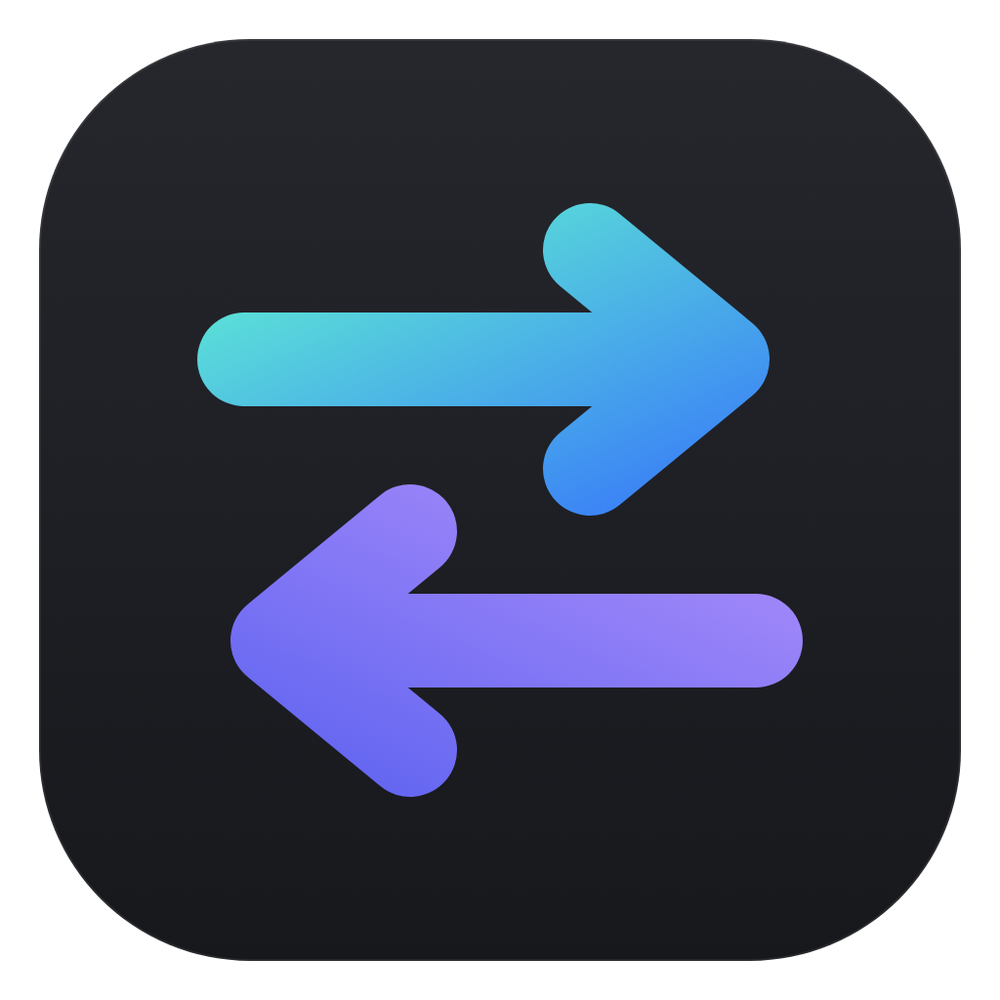
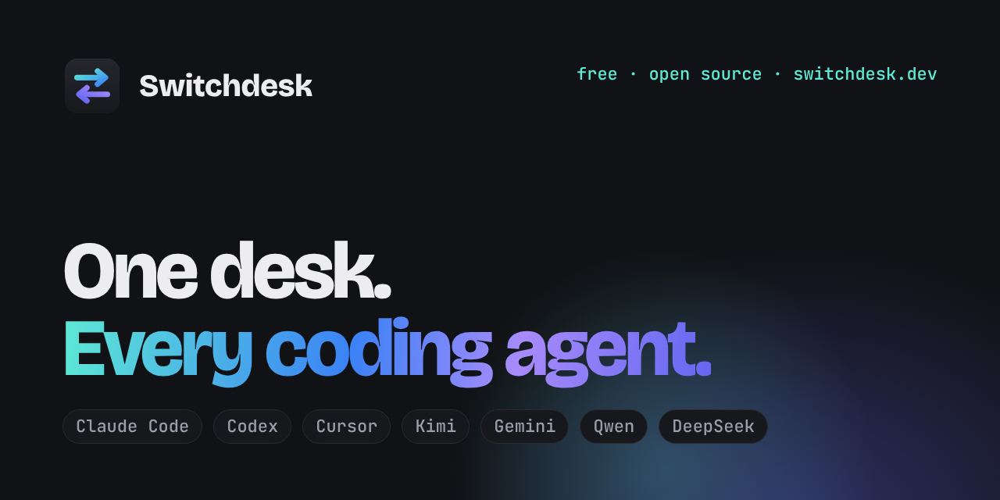

<div align="center">



# Switchdesk

**One desk. Every coding agent.**

A free, open-source, Cursor-style desktop editor for **Claude Code, Codex, GitHub Copilot, Cursor, Kimi, Gemini, Qwen and DeepSeek**.<br>
Each agent runs through its maker's own CLI, signed in with your own plan or API key.

[](https://github.com/SlaterMarketing/switchdesk/releases/latest)
[](https://github.com/SlaterMarketing/switchdesk/releases)
[](LICENSE)
[](https://github.com/SlaterMarketing/switchdesk/releases/latest)

[**Website**](https://switchdesk.dev) · [**Download for Windows**](https://github.com/SlaterMarketing/switchdesk/releases/latest) · [Run from source](#run-it) · [Report a bug](https://github.com/SlaterMarketing/switchdesk/issues/new/choose)



</div>

## Supported agents

| Agent | Signs in with | What Switchdesk runs |
| --- | --- | --- |
| Claude Code | Your Claude plan (several accounts side by side) | `claude -p --input-format stream-json` |
| Codex | Your ChatGPT plan or an OpenAI API key | `codex app-server` |
| GitHub Copilot | Your GitHub Copilot plan (`copilot login`) | `copilot --acp` |
| Cursor | Your Cursor plan (`agent login`) | `agent acp` |
| Kimi | Your Kimi Code membership | `kimi acp` |
| Gemini | Your Gemini API key | `gemini --acp` |
| Qwen | Your Alibaba Cloud API key | `qwen --acp` |
| DeepSeek | Your DeepSeek API key, through Qwen Code | `qwen --acp` |

Switchdesk never sees your logins. Switch any chat to another agent or account from the menu in the chat box and the new one picks up the conversation where the last left off.

Switchdesk was called Claude Desk until version 0.8. It isn't made by or affiliated with Anthropic, OpenAI, Anysphere (Cursor), Moonshot, Google, Alibaba or DeepSeek.

## What you get

- **Editor:** a Monaco (VS Code) editor with tabs, a file explorer, quick open (`Ctrl+P`) and save (`Ctrl+S`). The theme follows your system, or pick one in Settings.
- **Chat panel** with four modes. Cycle them with `Ctrl+.` or `Shift+Tab` in the chat box.
  - **Ask:** answers questions and never edits files. Any action that would change something is refused automatically.
  - **Plan:** researches first, then opens the plan in its own editor tab as a Markdown document you can edit freely (with a formatted **Preview**). Choose **Build it** (your edited version is what gets built) or **Keep planning** (send feedback). The chat card has the same buttons.
  - **Agent:** edits files without asking. Before Claude runs a shell command, you get an Allow / Always allow / Deny card.
  - **Auto:** Claude Code's auto mode. A safety classifier approves actions, and anything it won't approve comes to you as a card.
- **Chat tabs:** run several conversations side by side, each with its own Claude process. A spinner shows which ones are working, and the usage line shows turns and context size per chat.
- **Images:** paste a screenshot (`Ctrl+V`) or drag one onto the chat box.
- **Changes card after each turn:** a collapsed row (› 2 Files · Undo · Keep · Review) that expands to show every file the turn changed, including files changed by shell commands, with +/− counts and a diff. You can **Undo** each file or **Undo all**. In the diff, every change has its own **Undo** and **Keep** buttons.
- **Inline review:** Claude's edits show up right in the editor, with added lines in green and removed lines in red. Every change has its own **Keep** and **Undo**, and a bar at the bottom steps through changes and offers **Keep file**, **Undo file** and a side-by-side **Compare**. Changes from several turns stack up until you review them.
- **Rewind:** hover any message you sent and click **↺ Rewind**. The conversation goes back to just before it, the message returns to the chat box to edit and resend, and the files can go back too. This works with every agent: Claude Code forks the conversation, so the original stays in History, and the other agents start a new conversation that's given the one up to that point. Files can be rewound for messages sent since the app opened.
- **Terminal:** `Ctrl+`` opens a real terminal (PowerShell on Windows) in the project folder. Open several with +.
- **Fix with Claude:** the button in the terminal bar sends the output (or your selection) to Claude. It lights up when a command prints an error.
- **Preview** (`Ctrl+Shift+V`): your site in a tab next to the code. **Start dev server** runs your `dev` script, and any `localhost` address the terminal prints opens with one click. Console errors show as **Fix with Claude**. **Pick element** lets you click part of the page to attach it, with a screenshot, to the chat. 📷 attaches a screenshot of the whole page.
- **Parallel agents** (⑂, `Ctrl+Alt+N`): a chat that works in its own copy of the folder (a git worktree on its own branch), starting from your files as they are now. Run several at once. **Merge into my folder** brings the changes back as normal edits for inline review, combining them with anything you changed meanwhile. **Discard** deletes the copy and its branch.
- **Queue:** press Enter while Claude is working and the message waits its turn. Press Enter again in the empty box (or ↑ on a queued message) to send it now: Claude stops and reads it straight away, which is handy for steering it mid-task. Queued messages can be edited or removed, and pressing Stop pauses the queue.
- **Git panel** (`Ctrl+Shift+G`): changed files with diffs against the last commit, discard, commit (with a ✨ button that asks Claude Haiku to write the message), branches, push and pull.
  - **Merge conflicts:** a merge, rebase or cherry-pick that stops on conflicts shows what's left to do, with **Continue** and **Abort**. In the file, each conflict has **Accept current**, **Accept incoming**, **Accept both** and **Compare** above it, and **✨ Resolve with the agent** hands them to the chat. ✓ marks a file resolved.
  - **Blame:** who last changed the line you're on, when, and why, in grey at the end of the line (switch it off in Settings → General). Click the name in the status bar for that file's history.
  - **History:** the panel's History section lists recent commits; open one for its files and click a file to see what changed. Git: Show File History (in the command palette) shows every commit that changed the open file.
  - **Pull requests:** ✨PR on a branch writes the title and description from the branch's commits and diff (with Claude Haiku), and **Open on GitHub** starts the pull request with them filled in.
  - **Several repositories:** when the workspace has more than one folder with git, a menu at the top of the panel picks which one it shows.
- **Permissions for every agent** (Settings → Permissions): one set of rules that Claude, Codex, Copilot, Cursor, Kimi, Gemini, Qwen and DeepSeek all follow, so you don't approve the same thing once per agent.
  - **Skip all permission prompts** is the `--dangerously-skip-permissions` switch for every agent at once. Codex also leaves its folder sandbox. The status bar shows a warning while it's on.
  - **Run any command**, **edit files in the open folders** and **fetch web pages** without asking, each on its own.
  - **Always allowed commands** (`npm test`, `git *`) and **always blocked commands** (`rm -rf`, `git push`). A chained command (`a && b`) is allowed only if every part is, and blocked if any part is. Blocked commands stay blocked even when prompts are skipped.
  - **Always allow** on an approval card saves the rule for every agent.
  - Ask and Plan modes stay read-only whatever you set.
- **Settings** (`Ctrl+,`): your CLAUDE.md instructions (this project and all projects), saved permission rules, and MCP servers. These are Claude Code's own files, so they apply in the terminal too.
- **Context**
  - `@` in the chat box mentions a file or folder. `@codebase` finds the parts of the project your message is about and attaches them, so the agent starts in the right place. `@changes` attaches your uncommitted changes, `@terminal` the terminal's recent output (or what's selected in it), and `@` followed by a web address fetches that page and attaches its text.
  - `Ctrl+L` adds the editor selection to the chat.
  - `Ctrl+K` edits the selection in place.
- **Tab autocomplete:** grey suggestions as you type in the editor; Tab accepts, Esc dismisses. It runs GitHub's own Copilot language server signed in with your GitHub account (Copilot Free works), or fills in code with your DeepSeek or Qwen API key. Settings → Autocomplete installs the language server, signs you in to GitHub and picks the engine; the status bar shows which one is on.
- **Code intelligence:** go to definition (F12 or Ctrl+click, into other files too), hover info, completions, signature help, find references (Shift+F12) and errors as you type, from the language servers other editors use: TypeScript and JavaScript (TypeScript 7's built-in server, or typescript-language-server), Python (Pyright), Go (gopls), Rust (rust-analyzer) and C/C++ (clangd). Settings → Code intelligence shows which are installed and installs the missing ones in the terminal. The status bar counts errors and warnings; click it (or F8) for the next one.
- **Attach documents:** the paperclip in the chat box (or dragging files onto it) attaches files from anywhere on your computer, not just the workspace: Word (.docx), PDF, Excel (.xlsx), PowerPoint (.pptx), OpenDocument, RTF, HTML, text and code files, and images. Documents go to the agent as their text, with headings, tables, sheets, slides and speaker notes kept. Old .doc/.xls/.ppt files need saving in the newer format first, and scanned PDFs with no text should be attached as screenshots.
- **Search in files** (`Ctrl+Shift+F`): every file in the project, with match case, whole word, regex, and a files-to-include filter. Click a result to jump to it. **≈** searches by meaning instead: "where do we retry failed payments" finds the code that does it, whatever it's called.
- **Codebase search** (Settings → Codebase search): what `@codebase` and ≈ use. A small search model (all-MiniLM-L6-v2, about 50 MB, downloaded once) runs on your computer and indexes each folder you open in the background, keeping up as files change; nothing is sent anywhere. Results are merged with a keyword ranking so exact names still come first. Until it's switched on, both still work by keywords alone.
- **Slash commands:** type `/` in the chat box. Claude gets Claude Code's commands, including your own from `.claude/commands` and skills. Every other agent gets its own commands, plus `/init` (write an `AGENTS.md`), `/review` (review the uncommitted changes) and `/compact` (summarise the conversation and carry on in a fresh one), plus your own command files from `.claude/commands`, `.codex/prompts`, `.cursor/commands` and `.github/prompts` (in the project or your home folder), with `$ARGUMENTS` filled in. So a command you wrote for one agent works in all of them. `/clear` starts a fresh conversation in the tab.
- **Several windows:** File → New Window (`Ctrl+Shift+N`) opens another window, each with its own project, chats, agents and terminals, all running at once. Opening a folder that's already open takes you to its window. File → Open Recent lists your recent folders, the ⧉ button beside a recent folder opens it in a new window, and the Window menu switches between them. Quitting remembers every open window and reopens them all next time.
- **Workspaces with several folders:** File → Add Folder to Workspace (or ⊕ in the Explorer) adds another folder to the window, such as a shared library or the backend for this frontend. Each folder gets its own section in the Explorer, quick open and search cover all of them, and every agent in the window can read and change them: Claude Code gets `--add-dir`, Codex gets them as writable folders, Gemini and Qwen get `--include-directories`, and Copilot, Cursor and Kimi are told where they are. The changes card, inline review and Undo cover the extra folders too. Files in an extra folder show as `⟦name⟧/path`. The extra folders come back whenever the main folder opens; ✕ on a folder's row removes it from the workspace (the folder itself is untouched). The Git panel can switch to any of the folders; the terminal stays on the main folder.
- **Picks up where you left off:** open files and chat tabs come back when you reopen a folder.
- **History:** the Chats tab lists your past conversations for the open folder from every agent that keeps them (Claude Code, Codex, Copilot, Gemini, Qwen and DeepSeek), each tagged with its agent, including ones started in the terminal. Click one to read it and carry on.
- **Hand a chat to another agent:** switch agents in the middle of a chat and the new agent gets the conversation so far, so it carries on where the last one left off. The files stay as they were.
- **One set of rules for every agent:** Settings → Instructions has "Use one file for every agent", which keeps your project rules in `AGENTS.md` and points `CLAUDE.md` at it. Codex, Copilot, Cursor and Kimi read `AGENTS.md` themselves; Switchdesk gives it to Gemini, Qwen and DeepSeek.
- **Command palette** (`Ctrl+Shift+P`): every command, setting page, agent, account and recent folder, searchable by typing.
- **Light/dark switch:** the sun/moon button in the title bar. Settings also has a System option.
- **Taskbar flash:** when Claude finishes or needs you while the app is in the background, its taskbar button flashes (the Dock icon bounces on macOS) until you come back.
- **Status bar:** shows the CLI version, how you're signed in, and your 5-hour and 7-day usage. Click the usage to open Settings → Usage.
- **Usage page** (Settings → Usage): tokens and turns for each agent and Claude account today, this week and this month, Claude's cost at API prices, and each plan's 5-hour and weekly limits with when they reset.
- **Agents:** pick the agent for each chat from the menu in the chat box. It lists only the agents that are installed and signed in (or have a key), and each Claude account separately. Settings → Agents installs each one and signs it in (in the app's terminal, so you see exactly what runs), or takes an API key.
  - **Claude** runs Claude Code with your Claude plan.
  - **Codex** runs OpenAI's Codex CLI with your ChatGPT plan or an OpenAI API key. The model list comes from Codex itself.
  - **Copilot** runs GitHub's Copilot CLI with your GitHub Copilot plan, through `copilot --acp`. Sign in with `copilot login`.
  - **Kimi** runs Moonshot's Kimi Code CLI with your Kimi Code membership.
  - **Cursor** runs Cursor's own command-line agent (`agent`) with your Cursor plan, through `agent acp`, the connection Cursor provides for other editors. Sign in with `agent login`.
  - **Gemini** runs Google's Gemini CLI with your Gemini API key. (Google doesn't allow third-party apps to use a Google-account sign-in.)
  - **Qwen** and **DeepSeek** run Qwen Code (open source) with your Alibaba Cloud or DeepSeek API key. The API address and model can be changed, so other OpenAI-compatible providers work too.
  - Every agent gets the same chat panel, modes, approval cards, changes card, inline review, queue and parallel copies. API keys are stored encrypted with your operating system's keychain.
- **Several Claude accounts** (Settings → Accounts): stay signed in to a personal and a work account at the same time. Each folder uses your default account unless you tie it to another. The agent menu in the chat box lists each signed-in account with its email, so you can switch any chat at any time and the conversation carries on. The terminal, commit messages and the Settings pages follow the folder's account.
- **Model and effort pickers:** Opus, Sonnet, Haiku and Fable, and Low to Max effort.

## Install (Windows, no terminal needed)

1. Download **Switchdesk-Setup-x.y.z.exe** from the [latest release](https://github.com/SlaterMarketing/switchdesk/releases/latest) and run it. It installs for your user (no admin rights), adds Desktop and Start Menu shortcuts, and opens the app.
2. On first launch, a setup screen offers **Install Claude Code** (Anthropic's official installer) and **Sign in with Claude**, which opens your browser. When both are ticked, click **Start using Switchdesk**. If you'd rather start with Codex, Kimi or an API key, choose **Use another agent instead**.

Uninstall it from Windows Settings → Apps like any other app.

## Updates

The app checks this repo's Releases at start-up and every four hours, downloads new versions in the background, and shows **Restart to update** in the status bar. Help → Check for Updates checks straight away. If you ignore the button, the update installs the next time you quit.

To publish a new version: `npm run release`. That bumps the patch version, tags it and pushes, and the GitHub Action in `.github/workflows/release.yml` builds the Windows installer and publishes the release. You can also bump the version in `package.json`, push, and run the **Release** action by hand from the Actions tab.

## Requirements (running from source)

1. **Claude Code CLI**, installed and signed in. The app's setup screen can do both for you.
2. **Node.js 20 or newer**, only if you run the app from source.

## Run it

```
npm install
npm start
```

## Build an installer

```
npm run dist:win     # Windows installer in dist/ (GitHub Actions builds the released one)
npm run dist:mac     # needs a Mac
```

The build is unsigned, so the first install shows "Windows protected your PC". Click **More info**, then **Run anyway**. Updates after that install without the warning.

## How it works

- `src/session.js` keeps one `claude -p --input-format stream-json --output-format stream-json` process per chat tab, so follow-up messages skip start-up. Modes map to `--permission-mode` (`default`, `plan`, `acceptEdits`, `auto`) and switch live.
- Approvals use Claude Code's stdio permission prompts (`--permission-prompt-tool stdio`): the CLI asks, the app shows a card, and your click goes straight back.
- `src/snapshots.js` takes a git snapshot of the folder (into a temporary index, without touching your staging area or history) before and after each turn. That's what the changes card, diffs and Undo use, so shell-made changes are covered too. Folders that aren't git repositories fall back to copies of files Claude edits.
- `src/updater.js` uses electron-updater against GitHub Releases.
- `src/terminal.js` runs the terminal through node-pty. `src/gitops.js` runs your own git, so it uses your existing credentials.
- Conversations are Claude Code's own transcripts in `~/.claude/projects/`, so the terminal and the app share history.
- `src/worktrees.js` makes the copies for parallel agents under the app's data folder and merges with `git merge-file`.
- `src/codex-session.js` runs `codex app-server`, the JSON-RPC mode OpenAI provides for apps that embed Codex. `src/acp-session.js` speaks the [Agent Client Protocol](https://agentclientprotocol.com) to Copilot (`copilot --acp`), Cursor (`agent acp`), Kimi (`kimi acp`), Gemini CLI (`gemini --acp`) and Qwen Code (`qwen --acp`). Both translate the agent's events into the same shapes Claude Code's stream-json uses (`src/agent-events.js`), so the chat panel is shared.
- Each extra account is its own Claude Code config folder under the app's data folder, passed to the CLI as `CLAUDE_CONFIG_DIR`, so its sign-in, settings and history stay apart. Switching a chat to another account copies its transcript across before resuming it.
- Rewind resumes with `--resume <session> --resume-session-at <reply> --fork-session`, and restores files from the turn's git snapshot.

## Limits

- There's no Cursor-style Tab autocomplete, because Claude Code doesn't offer it.
- In a folder that isn't a git repository, Undo only covers files changed by Edit and Write. The git panel can turn the folder into a repository in one click.
- The app isn't code-signed (that needs a paid certificate).
- In Plan mode, Claude's question cards send your answer back as text.

## Terms

This app runs the unmodified Claude Code binary, which you sign in to yourself, for your own use. That matches what Anthropic's [legal and compliance page](https://code.claude.com/docs/en/legal-and-compliance) allows. Don't ship it to other people as a product on your subscription: anything you offer to others has to use their own login or API keys.

## Contributing

Issues and pull requests are welcome. See [CONTRIBUTING.md](CONTRIBUTING.md) for how to run the app and send a change. The website at [switchdesk.dev](https://switchdesk.dev) lives in [`site/`](site).

## Licence

[MIT](LICENSE). Free to use, change and share.
